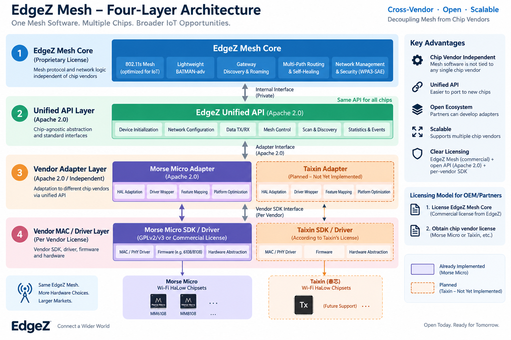

# edgez-rf-api

Vendor-neutral C interfaces between the EdgeZ UMAC and radio backends.

Upper layers depend only on this repository. Vendor adapters, including
`edgez-rf-morsemicro`, implement `edgez_rf_backend_ops` and the generic binding
entry points without exposing vendor packet or driver types to the UMAC.

The public headers cover the radio backend contract, runtime status API, and
the optional mesh/Hostap event bridge. The API is licensed under Apache-2.0.

## Layered architecture

`edgez-rf-api` is layer 2, the Apache-2.0 unified API. The proprietary EdgeZ
Mesh core above it uses only these chip-agnostic contracts. Vendor adapters
below it implement the contracts and translate them to a vendor SDK; the core
must not include vendor headers, expose vendor packet types, or call vendor
driver symbols directly.

For Morse Micro hardware, `edgez-rf-morsemicro` implements layer 3. The Morse
Micro SDK and driver remain a separate layer-4 dependency under their own
licenses. Adding another chip family should require another layer-3 adapter,
not changes to this API or vendor-specific dependencies in the mesh core.
